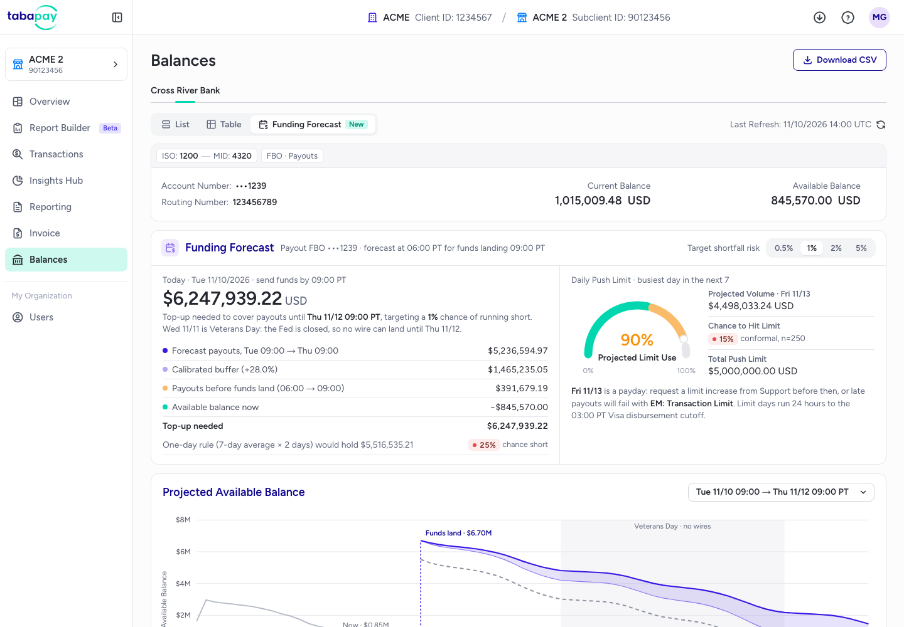

# Funding Forecast for the TabaPay Portal (concept)

**Live demo:** https://mohith26.github.io/tabapay-funding-forecast/

A concept feature for the Balances page of the TabaPay Portal: it tells a payout client **how much to wire into its prefunded (FBO) account today** so instant payouts don't run out of money before the next business-day funding lands, at a shortfall risk the client picks (0.5%, 1%, 2% or 5%). It also gives the chance of hitting the daily push limit on each upcoming day.

Unofficial concept demo by Mohith Gajjela. Not affiliated with TabaPay. All data is synthetic.



## Why

TabaPay runs a prefunded (good funds) model for disbursements. The settlement guide asks clients to "maintain at least one day's forecasted disbursement activity in the FBO account" plus extra for weekends and bank holidays, because Friday through Sunday activity settles on Monday. The Balances page lists "Forecasting liquidity" and "Making funding decisions" as its use cases, but it shows current and available balances only. The Overview page estimates settlement for activity that has already happened (today and tomorrow), and limit alerts fire at 90% of the daily limit. Nothing in the portal looks forward.

The forward question is harder than it sounds:

* A funding window is not one day. Tuesday's wire has to cover until Thursday when Wednesday is Veterans Day; Wednesday before Thanksgiving covers to Friday; Friday covers to Monday.
* Payout volume moves with paydays, month starts, weekdays and holidays, so a trailing average is wrong in a predictable direction on exactly the days that matter.
* Too little cash means declined payouts; too much means idle cash that could be earning elsewhere. The client needs a number with a stated risk, not a rule of thumb.

## What the demo shows

* **Today's top-up**: forecast payouts for the window, a calibrated buffer, payouts expected before funds land, and the available balance, adding up to the wire amount.
* **Daily push limit gauge** (the portal's own gauge component): projected use of the limit on the busiest upcoming day and the chance of hitting it, so a limit increase can be requested in time.
* **Projected available balance** chart for any window: median path, calibrated low path, the one-day rule's low path, and where it would run dry. Non-business days are shaded.
* **Funding calendar** for the next 12 windows (through Thanksgiving) with the recommended balance next to the one-day rule and that rule's chance of running short.
* **Backtest** over 237 historical funding windows, each decided with only data available at 06:00 PT that day.

## How it works (`core/forecast.js`)

1. **Daily payout model.** Weighted ridge regression of log daily volume on calendar facts known in advance (trend, weekday, biweekly payday, day after payday, month start, major/minor Fed holiday, day before a holiday) over the last 52 weeks, with a 91-day half-life so recent weeks dominate. The latest residual carries forward as AR(1).
2. **Hourly shape.** Per-weekday median intraday shares over the trailing 6 weeks, so a 09:00-to-09:00 window gets the right fraction of each day.
3. **Window error scale.** Each window's log-scale σ comes from the AR(1) covariance of the days it spans plus hourly noise, so a Friday-to-Monday window and an overnight window are put on one scale.
4. **Calibration.** Normalized split conformal prediction on s = log(actual / forecast) / σ over the most recent 250 completed windows (finite-sample order statistic ⌈(n+1)(1−α)⌉). Recommended balance = forecast × exp(q·σ). Adaptive conformal inference (Gibbs and Candès, 2021) adjusts the level after every outcome, with step 0.1·α. If a target needs more history than exists (for example 0.5% with fewer than 199 windows) the page says the level is not certified.
5. **Daily limit risk.** The same model forecasts each 24-hour limit day (to the 03:00 PT Visa disbursement cutoff), and a conformal p-value of the remaining headroom gives the chance of hitting the limit.

Every number on the page is computed in the browser from `data/flows.json` by this code; nothing is hard-coded. `node scripts/report.js 0.01` prints the same numbers from the command line.

## Results on the synthetic data (1% target)

| Policy | Windows short (of 237) | Avg unused balance |
|---|---|---|
| One-day rule (7-day average × days covered) | 91 (38.4%) | $0.19M |
| Current practice (1.1× one-day rule) | 53 (22.4%) | $0.40M |
| Flat buffer sized to match (1.34× one-day rule) | 4 (1.7%) | $1.09M |
| **Funding Forecast** | **4 (1.7%)** | **$0.74M** |

At the same number of shortfalls, the forecast held 32% less idle cash than a flat buffer on the one-day rule. Realized shortfall rates were 0.4% / 1.7% / 2.5% / 5.5% for targets of 0.5% / 1% / 2% / 5%.

## Data

`scripts/generate.js` (seed 20261110) simulates one client's hourly payout volume (PT) from Jan 6 2025 to Tue Nov 10 2026 06:00 PT: growth, a new sub-client going live in August 2026 (+12%), weekday and intraday patterns, biweekly Friday paydays, month starts, Fed holidays (major ones lower), persistent busy-day shocks, hourly noise, and occasional bulk payout files. The forecaster never sees the generator's parameters.

## Tests

```
node --test test/*.test.js
```

11 tests: linear algebra, ridge recovery, the conformal order statistic and the uncertifiable case, empirical coverage on exchangeable scores, conformal p-values, the holiday/payday calendar, windows tiling time, hourly paths summing to totals, **no look-ahead** (tripling all data after the decision hour leaves the forecast unchanged), backtest calibration at 1% and 5%, and monotonicity of recommendations in the target.

## Honest limitations

* Synthetic data. Real payout volume has features this generator lacks (outages, client-side batching, promotions, fraud spikes), and the realized rate here (1.7% at a 1% target, 4 shortfalls in 237 windows) is within binomial noise but above target.
* The calibration window (250) and ACI step (0.1·α) were chosen on this same backtest after trying 150, 200 and 250 windows and a few step sizes; results at other settings were similar (1 to 4 shortfalls at 1%).
* Assumes a wire sent at the 06:00 PT decision lands by 09:00 PT on business days. Real wire cutoffs differ by bank.
* Network fees, interchange, ACH returns and representments are left out of the outflow; volume above the daily limit is treated as demand.
* The page is a static concept. The sidebar order beyond Overview, Report Builder and Transactions is inferred from TabaPay's portal docs, and Figtree stands in for the portal's typeface.

## Novelty

Checked TabaPay's developer docs (Balances, Portal Overview, Settlement, Daily Settlement Operations, Program FAQs, Insights Hub, Report Builder), the changelog from Nov 2025 to Oct 2026, the 2026 website and the September 2026 funding announcement. The portal shows real-time balances, estimated settlement for processed activity and 90% limit alerts, and the announcement mentions merchant liquidity solutions in general terms; none of them forecast funding needs or attach a risk level. Visa Direct's stablecoin prefunding (with Inyo, Oct 2026) attacks the same funding-window problem from the funding side, which complements a forecast rather than replacing it.
